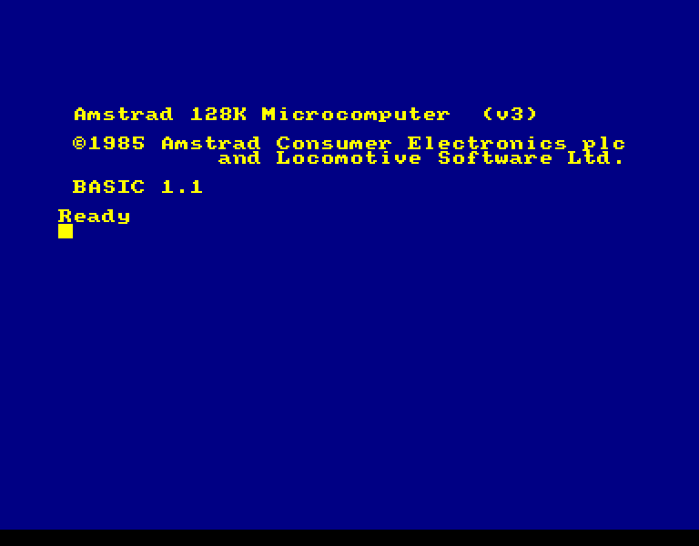
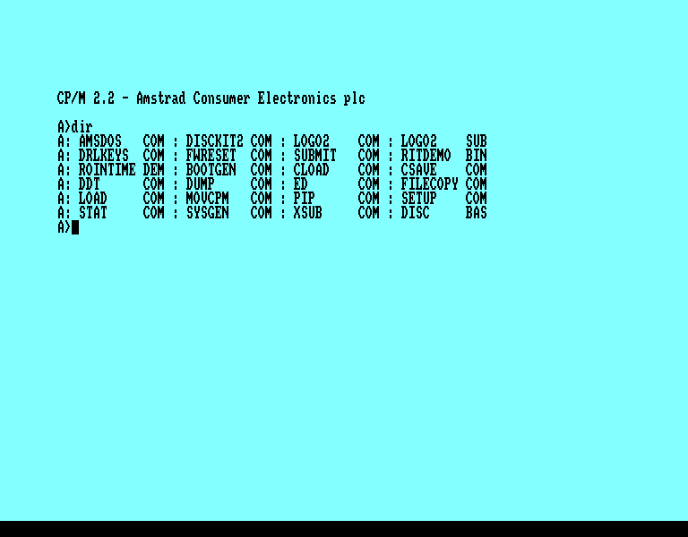
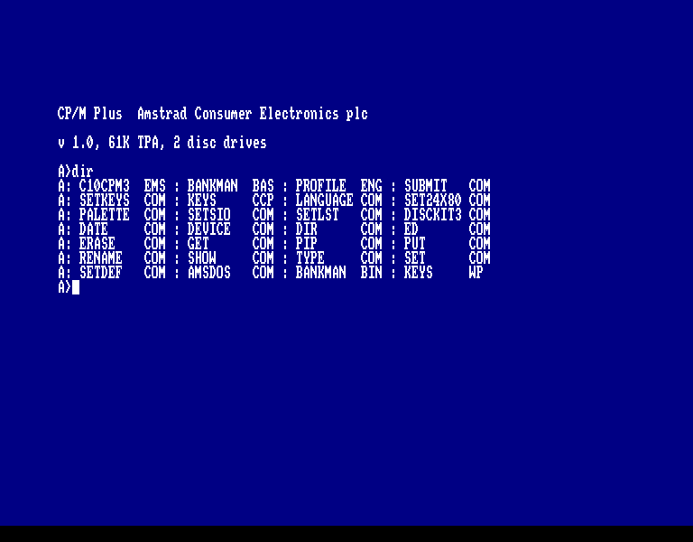
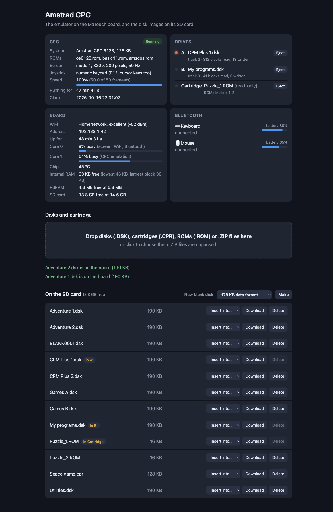
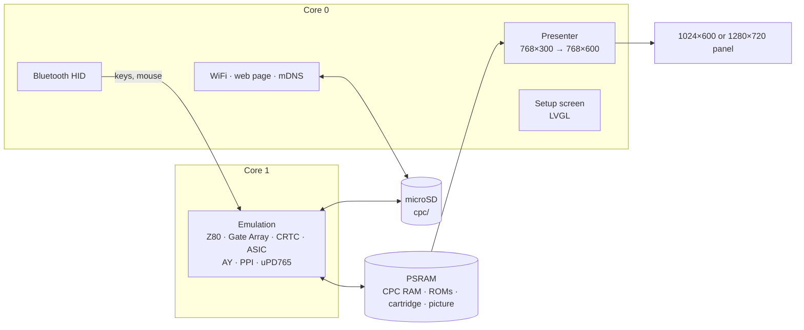

<h1 align="center">esp32cpc</h1>

<p align="center">
  <b>An Amstrad CPC 464, 664, 6128, 464 Plus or 6128 Plus on a 7-inch ESP32-S3 touch-screen board or an M5Stack Tab5.</b><br>
  Z80 with the real CPC timing, Plus hardware sprites and 4096 colours, disks, cartridges, Bluetooth keyboard and mouse.
</p>

<p align="center">
  
  
  
  
  
  
</p>

<p align="center">
  <b>Work in progress:</b> not everything has been tested, and games and demos may or may not
  work satisfactorily.
</p>

<p align="center">
  
  
  <br>
  
  <br>
  <sub>The CPC 6128 starting up in BASIC 1.1, CP/M 2.2 started with <code>|CPM</code>, and CP/M Plus
  (61K TPA: it needs the 6128's second 64 KB) from its system disk. Screenshots from the board,
  border included; every scanline is shown twice on the panel.</sub>
</p>

esp32cpc turns the Makerfabs MaTouch ESP32-S3 Parallel TFT with Touch 7", or an
M5Stack Tab5, into an Amstrad CPC. The whole monitor picture, border included, fills the
panel's height at mode 2 resolution; a Bluetooth keyboard (and mouse, if you
like) work the CPC, and disk images and cartridges come from the microSD
card. A setup screen on the touch panel, and a web page on your network,
handle everything else.

It's the sibling of [esp32ste](https://github.com/rlucencic/esp32ste) (Atari
STE), [esp32mac](https://github.com/rlucencic/esp32mac) (Macintosh Plus, SE,
Classic), [esp32mac2](https://github.com/rlucencic/esp32mac2) (Macintosh LC
and II, Tab5 only), [esp32mac3](https://github.com/rlucencic/esp32mac3)
(Macintosh LC II and LC III, Tab5 only),
[esp32zx](https://github.com/rlucencic/esp32zx) (ZX Spectrum),
[esp32cbm](https://github.com/rlucencic/esp32cbm) (Commodore 64 and 128),
[esp32xl](https://github.com/rlucencic/esp32xl) (Atari 800XL and 130XE),
[esp32msx](https://github.com/rlucencic/esp32msx) (MSX1 and MSX2),
[esp32gs](https://github.com/rlucencic/esp32gs) (Apple IIGS),
[esp32coco](https://github.com/rlucencic/esp32coco) (Tandy Color Computer 2
and 3) and
[esp32pc](https://github.com/rlucencic/esp32pc) (IBM PC/XT and PC/AT);
all are built on the shared runtime
[esp32emu](https://github.com/rlucencic/esp32emu).

## Features

**The machine**
- **Five models**, chosen on the setup screen: CPC 464, 664 and 6128, and
  the 464 Plus and 6128 Plus, each with its own RAM (64 KB; 128 KB on the 6128s)
- Locomotive BASIC, AMSDOS, CP/M 2.2 and CP/M Plus from the original disks
- Z80 that passes zexall, timed like the CPC's: the Gate Array stretches every
  instruction to whole microseconds, and I/O happens at the right microsecond
  inside it, so raster effects land where they should
- 6845 CRTC as counters (split screens, overscan, rupture tricks), Gate Array
  with mid-line colour and mode changes, interrupts every 52 lines
- AY-3-8912 sound (A left, C right, B in the middle) and the keyboard matrix
- **Plus ASIC**: 4096 colours, 16 hardware sprites with magnification,
  split screen, soft scroll, programmable raster interrupt, three DMA sound
  channels, IM 2 vectors; unlocked by the usual sequence

**Disks and cartridges**
- Drives **A:** and **B:** for `.dsk` images (standard and extended DSK,
  including weak sectors and sector status for protected disks); the 464 gets
  a disc drive too, like a DD1
- **New blank disks**, formatted (data or system format), ready for `SAVE`
- **Cartridge slot**: Plus cartridges (`.cpr`), or expansion ROMs (`.rom`,
  with or without an AMSDOS header) in the upper ROM slots, like a ROM board.
  Games converted to ROMs come in parts (`NAME_1.ROM`, `NAME_2.ROM`):
  inserting the first brings the others along; start them with `|NAME`
- Disk writes go back to the SD card a second after they happen

**Around it**
- **Setup screen** before the CPC starts, and any time while it runs (hold the
  top-right corner for 2 seconds): WiFi, Bluetooth pairing, model, disks, reset
- **Clock from the internet**, which the CPC sees through a Symbiface II
  real-time clock (SymbOS shows the right time)
- **Bluetooth keyboard and mouse** (BLE HID). The mouse is an AMX mouse on
  the joystick port and a Symbiface II PS/2 mouse at the same time
- **Joystick** on the numeric keypad, and on the cursor keys after F12
- **Web page** at `http://amstrad.local`: drop disk images, cartridges, ROMs or
  `.ZIP` files onto it (with a progress bar), put them into drives, eject, make
  blank disks, and watch the CPC, drives, board and Bluetooth devices live
- **Sound** on the board's speaker (optional, `menuconfig`)

<p align="center">
  
  <br><sub>The web page, right after a ZIP file with two disk images was dropped on it (example data)</sub>
</p>

## Hardware

| | Makerfabs MaTouch ESP32-S3 7" | M5Stack Tab5 |
|---|---|---|
| Chip | ESP32-S3-WROOM-1-N16R8: 16 MB flash, 8 MB octal PSRAM | ESP32-P4 (RISC-V, 360 MHz): 16 MB flash, 32 MB PSRAM; an ESP32-C6 for WiFi and Bluetooth |
| Screen | 7" 1024×600 RGB, GT911 capacitive touch | 5" 1280×720 MIPI-DSI, capacitive touch, held landscape |
| Storage | microSD card (FAT32 or exFAT) | microSD card (FAT32 or exFAT) |
| Input | any BLE keyboard, optionally a BLE mouse | any BLE keyboard, optionally a BLE mouse, or the Tab5 Keyboard |
| Sound | a speaker on the MAX98357A output (optional, `menuconfig`) | the built-in speaker (ES8388) |

The CPC's picture is 768×300 (48 characters of 16 mode 2 pixels by 300
scanlines, the border included); every scanline is shown twice, so it fills
the panel's height as 768×600, which is also about the shape of the picture
on a CPC monitor. On the Tab5 it is 922×720 (every scanline 2.4 times).

## Getting started

### 1. What you need

- [ESP-IDF](https://github.com/espressif/esp-idf) v5.5 (developed with v5.5.4)
- [esp32emu](https://github.com/rlucencic/esp32emu), checked out next to this project (`../esp32emu`)
- The CPC ROM images in `roms/` (see [roms/README.md](roms/README.md))
- A microSD card, FAT32 or exFAT

### 2. Build and flash

```sh
git clone https://github.com/rlucencic/esp32emu.git     # the shared runtime, next to it
git clone https://github.com/rlucencic/esp32cpc.git && cd esp32cpc
idf.py build
idf.py -p /dev/cu.usbmodem… flash      # app and the ROM images

# or for the M5Stack Tab5 (its own build folder and settings):
idf.py -B build-tab5 -DIDF_TARGET=esp32p4 -DSDKCONFIG=build-tab5/sdkconfig build
idf.py -B build-tab5 -DIDF_TARGET=esp32p4 -DSDKCONFIG=build-tab5/sdkconfig -p /dev/cu.usbmodem… flash
```

Later updates only need `idf.py -p … app-flash`. Instead of flashing the
ROMs, you can also copy them into a `roms` folder on the SD card.

### 3. First start

1. The board starts on the **setup screen**. Tap **WiFi** to join your
   network: the clock is set from the internet, and the web page becomes
   reachable.
2. Tap **Bluetooth** to pair a keyboard (and a mouse, if you want one).
3. Choose the **model**, then tap **Start**.
4. Open `http://amstrad.local` and drop disk images or cartridges onto the
   page, then **Insert into… → A:** (or **Cartridge**).

## Using it

| To | Do |
|---|---|
| Get back to the setup screen | Hold the top-right corner of the screen for 2 s |
| Change the model | On the setup screen; **Restart** applies it |
| Insert a disk | Web page: **Insert into…**, or setup screen → **Disks** → **Insert disk** |
| Catalogue and run | `CAT`, then `RUN"NAME` (CP/M: `|CPM` with a CP/M system disk) |
| Make a blank disk | Web page: **New blank disk**, or setup screen → **New empty disk** |
| Play a Plus cartridge | Insert the `.cpr` into **Cartridge** on a 464 Plus or 6128 Plus: the Plus restarts from it |
| Use expansion ROMs | Insert the `.rom` into **Cartridge**: the CPC restarts with it in slot 1 (2, 3 ... for more parts); then `|NAME` |
| Copy files from a computer | Drop them onto the web page (ZIP files are unpacked), or `curl -T game.dsk http://amstrad.local/disks/` |

Disk images, cartridges and ROMs live in the `cpc` folder on the SD card.
The inserted ones are remembered across restarts.

**Keyboard**: keys by position, a UK CPC keyboard on a PC keyboard. F1–F10
are the CPC's f1–f0 keypad keys and F11 its `.`; keypad Enter is ENTER,
Insert is COPY, Delete is CLR, Backspace is DEL, Alt is COPY.

**Joystick**: the numeric keypad (8 4 6 2 and the diagonals, 5 or 0 fire,
`.` second fire). F12 makes the cursor keys the joystick as well, with Alt
as fire; F12 again gives them back.

**Mouse**: art and desktop programs that know the AMX mouse (joystick port)
or the Symbiface II mouse (SymbOS) follow a Bluetooth mouse.

## Configuration

`idf.py menuconfig` → **Emulator board**:

| Option | Default | |
|---|---|---|
| WiFi, setup screen | on | Time zone for the clock (POSIX TZ) |
| Start by itself | off | Countdown on the setup screen |
| Web page, network name | on, `amstrad` | `http://<name>.local` |
| BLE keyboard and mouse | on | Mouse speed divider |
| Sound on the speaker | off | Volume; moves the console to the UART port |

## How it works



- **`components/cpc`**: the CPC, platform independent. It also builds on a
  desktop (`components/cpc/host`) for testing with scripted typing,
  joystick and mouse, screenshots, sound recording and CPU traces.
- **`main`**: the CPC on the board: memory, ROMs, settings, keyboard map,
  drives and status.
- **[esp32emu](https://github.com/rlucencic/esp32emu)**: the board runtime,
  the Z80 core (timed in CPC microseconds here) and the uPD765 floppy
  controller, shared with [esp32zx](https://github.com/rlucencic/esp32zx)
  (the Z80 also with [esp32cbm](https://github.com/rlucencic/esp32cbm)'s C128
  and [esp32msx](https://github.com/rlucencic/esp32msx)).

Time runs in CRTC characters (1 µs). The video advances with every
instruction, drawing each character inside the monitor's visible window
with the colours and mode of that moment; the monitor locks onto the
CRTC's HSYNC and VSYNC, so programs that move or resize the picture move it
on the panel too. Only every other picture is drawn (the panel shows 25 a
second anyway), and only lines that changed are copied.

## Development

```sh
make -C components/cpc/host                                     # desktop build of the CPC
make -C ../esp32emu/components/z80/test                         # the Z80 exerciser:
../esp32emu/components/z80/test/build/z80_test_cpc zexall.cim
CPC_DISKA=game.dsk components/cpc/host/build/cpc_host 6128 500 out.ppm

python ../esp32emu/tools/emu_console.py /dev/cu.usbmodem… lcd screen.png   # screenshot of the panel
python ../esp32emu/tools/emu_console.py /dev/cu.usbmodem… send 'T cat\n'  # type on the CPC
curl http://amstrad.local/api/status                                       # live status as JSON
```

`CLAUDE.md` has the details: architecture, timing, the Plus, debugging
options and the lessons learned along the way.

## Limitations

- The M5Stack Tab5 port is new: the machine starts there and runs at full
  speed at its start-up screen, with core 1 far less busy than on the S3,
  but sound, touch, Bluetooth and the Tab5 Keyboard have not been tried on
  it by hand yet.
- No cassette (tapes as `.cdt`/`.wav`), printer, or serial interfaces.
- One CRTC behaviour for all models (no type 0/1/2 quirks); demos that rely
  on a particular CRTC type may look different.
- The floppy controller has no rotation timing: protections that measure it
  fail.
- Plus: no analogue joysticks or light gun; sprites only over the screen
  area, not the border.

## Credits

- [Caprice32](https://github.com/ColinPitrat/caprice32), the Arnold V
  specification, [MAME](https://github.com/mamedev/mame) and
  [konCePCja](https://github.com/ikari-pl/konCePCja): the references for
  how the CPC, the Plus ASIC and the Symbiface II behave
- The zexdoc/zexall Z80 exercisers by Frank Cringle
- [LVGL](https://lvgl.io) for the setup screen
- [ESP-IDF](https://github.com/espressif/esp-idf) and NimBLE

## Licence

[MIT](LICENSE). LVGL (MIT) and ESP-IDF (Apache 2.0) are fetched at build time
and keep their own licences.

Amstrad and CPC are trademarks of their owners. The ROM images are not part
of this repository.
